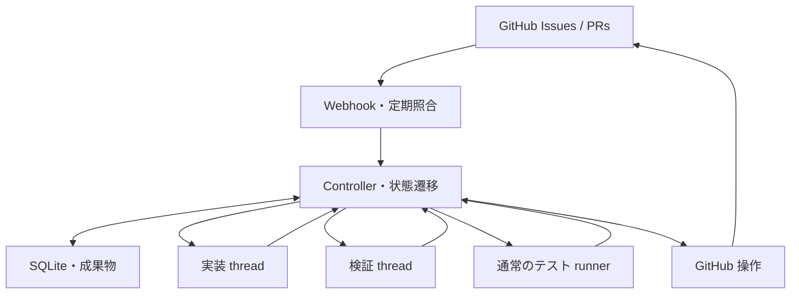

# Codex Issue / PR 実装ハーネス 実装計画書

| 項目 | 内容 |
| --- | --- |
| 文書版 | v0.1 |
| 作成日 | 2026-10-20 |
| 状態 | 設計案。外部サービスの接続契約は PR 0 で検証する |
| 対応する要件 | [要件定義書](requirements.md) |
| 対象 | Codex app-server、GitHub Issues / Pull Requests、Codex Cloud review を連携するハーネス |
| 本文の範囲 | 実装する構成、データ・処理契約、実装順序、検証方法。実装コードはまだ作成していない |

## 1. 実装方針

通常のプログラムが、Issue の取得、実装・検証 session の起動、テスト実行、PR、レビュー、merge、再試行を管理する。
Codex を呼ぶのは、製品コードの実装・修正、テストの設計・追加、判断が必要な失敗の切り分け、Issue 分割案などに限定する。
実装用と検証用の thread を WorkItem ごとに保持し、外部処理へ引き渡したらターンを終了する。

本計画での重要な区別は次の通り。

- ターンの正常終了は、候補が完成したことやテスト合格を意味しない。構造化出力と実際の成果物を確認する。
- 中断は正常な引き渡しではない。中断された作業は復旧または保留の対象にする。
- テスト待ち、CI 待ち、レビュー待ち、merge 待ちの通常処理では LLM を呼ばない。
- 検証担当が追加したテストを含む commit を、正式な検証・Cloud review の対象にする。
- 指摘のない応答、未完了、一般コメントを承認に読み替えない。
- 部分 PR の残作業は merge 前に保存し、親 Issue の完了と個々の PR の完了を分ける。

### 1.1 この文書で採用する初期構成

以下は実装を具体化するための設計選択であり、既存のユーザー環境を確認して決めたものではない。

| 項目 | 初期案 | 理由・変更条件 |
| --- | --- | --- |
| 実装言語 | TypeScript / Node.js | app-server の生成 TypeScript 定義と同じ言語で接続契約を扱う |
| 実行形態 | 単一ホストの常駐サービス | 初期の復旧・排他・運用を一つの管理単位にまとめる |
| 永続化 | SQLite と成果物用ディレクトリ | 状態、操作予定、実行証拠を保持する |
| app-server 接続 | ローカル子プロセスと stdio | 接続境界を明確にし、外部公開を要件にしない |
| モデル | 設定で指定し、利用可能性を接続検証する | モデル名・利用権限・費用を未確認のまま固定しない |
| Codex バイナリ | 採用版と生成 schema を固定 | 更新時にプロトコル互換性を確認する |
| GitHub 操作主体 | 専用 GitHub App を第一候補に検証 | 自動操作の主体と権限を明確にする |
| 初期並列度 | active turn 1、進行中 PR 1、runner job 1 | 直列の完走と復旧を先に成立させる |
| 承認方式 | `github_native_approved` | 信頼する reviewer の正式な `APPROVED` と対象 SHA を確認する |
| 自動 merge | 接続契約が成立するまで無効 | Cloud review の承認表現を未検証のまま有効化しない |

app-server の型生成、thread / turn API、イベントの形は公式資料を参照し、実際に採用するバイナリの生成 schema を実装上の基準とする。[S1]

### 1.2 PR 0 の結果で決める事項

| 要件書の ID | 未確定事項 | 確認・決定する工程 | 未成立の場合 |
| --- | --- | --- | --- |
| OQ-001 | 指摘なし時に Cloud が正式な `APPROVED` を返すか | PR 0 で clean review の API 結果を保存する | 自動 merge は保留し、承認の定義について仕様判断を残す |
| OQ-002 | GitHub App 等の採用主体で `@codex review` が起動するか | PR 0 で実際に依頼する | 設定済み自動レビューなど別の正式な起動経路を検証する |
| OQ-003 | review を候補 SHA / round に対応付けられるか | PR 0 で再依頼、遅延結果、失敗応答を採取する | 不確実な結果を `INCONCLUSIVE` とする |
| OQ-004 | repository、base、pool、認証 | PR 0 の検証対象と、導入対象ごとに設定する | 対象 Issue を取得しない |
| OQ-005 | Codex、モデル、履歴保存、sandbox | PR 0 で停止・再起動後の再開も確認する | 永続化・実行条件を修正して再検証する |
| OQ-006 | 必須 profile と成功の意味 | PR 3 / PR 4 と導入時に定義する | 必須検証を完了扱いにしない |
| OQ-007 | token、CI、GitHub rules の連携 | PR 0 / PR 5 で PR 作成・push・gate を確認する | token / workflow 設定を見直す |
| OQ-008 | 予算、保存期間、照合周期、通知先 | PR 7 と導入時に設定する | 必須設定が不足する機能を保留する |

Cloud の公開連携には PR コメントによるレビュー依頼があるが、上表の環境固有の成立までは保証されたものとして扱わない。[S2]
自動 merge の接続契約が未成立でも、状態管理、実装、独立検証、runner、分割機能の開発は進められる。

## 2. 構成と責務



LLM を使う担当は実装 thread と検証 thread。Cloud review は GitHub 連携を通じて依頼する外部工程である。

### 2.1 モジュール

以下のパスは作成予定の配置案である。

| モジュール | 配置案 | 責務 |
| --- | --- | --- |
| CLI / service | `src/cli/`, `src/service/` | 起動、停止、状態確認、操作要求の受付 |
| Scheduler | `src/scheduler/` | Issue pool、取得、依存関係、実行枠 |
| Domain / reducer | `src/domain/` | 状態、判定条件、イベントから次の操作を決める純粋処理 |
| Storage | `src/storage/` | migration、transaction、inbox、outbox、排他 |
| Codex adapter | `src/adapters/codex/` | app-server 接続、要求・通知・承認要求、thread / turn 管理 |
| GitHub adapter | `src/adapters/github/` | Issue、PR、reviews、checks、merge の API 操作 |
| Review adapter | `src/review/` | Cloud 依頼、round 対応付け、結果の正規化 |
| Workspace | `src/workspace/` | worktree、候補 commit、変更の取り込み |
| Verification | `src/verification/` | 検証計画、テスト変更、失敗分類、修正の差し戻し |
| Runner | `src/runner/` | 検証 profile の実行、終了検知、結果・ログ |
| Policy | `src/policy/` | 必須検証、権限、承認条件、予算、設定版 |
| Generated protocol | `src/generated/codex/` | 採用バイナリから生成したプロトコル定義 |
| Domain schemas | `schemas/handoffs/` | ハーネス独自の引き渡し契約 |

生成した app-server 型と、ハーネス独自の型を分離する。
外部 schema の変更は adapter 内で吸収し、workflow に外部の生レスポンスを直接流し込まない。

## 3. ドメインと識別子

| 単位 | 主な識別子 | 制約 |
| --- | --- | --- |
| Repository | GitHub repository ID | 名前変更と区別して追跡する |
| Issue | repository ID + issue number | pool と元要求の単位 |
| Scope revision | scope ID + revision | 受入条件と今回の範囲を固定する |
| WorkItem | 内部 UUID | 一つのレビュー・merge 可能な範囲 |
| Role thread | WorkItem ID + role | 実装用、検証用を別々に保持する |
| Agent run | 内部 UUID + thread / turn ID | 一回の起動意図と結果 |
| Candidate | 内部 UUID + commit SHA | 製品コードとテストを含む固定候補 |
| Validation run | 内部 UUID | candidate、実行環境、profile 版に結び付く |
| Review round | PR + candidate + round number | 依頼と結果を結び付ける |
| Operation | 内部 UUID | 外部操作の予定・結果・不明状態 |

基本関係は `Issue 1 → N WorkItem`、`WorkItem 1 → 1 主 PR`、`WorkItem 1 → 役割ごとの thread` とする。
一つの PR の修正で新しい WorkItem を増やさず、candidate と run を追加する。
次の部分 PR は新しい WorkItem とし、前の WorkItem への依存を保存する。

## 4. 状態と判定条件

### 4.1 WorkItem の phase

| Phase | 意味 | 通常の実行主体 |
| --- | --- | --- |
| `READY` | 依存が解消し実行可能 | Scheduler |
| `IMPLEMENTING` | 製品コードの実装・修正 | 実装 thread |
| `VERIFYING` | 検証計画・テスト作成、必要な結果解釈 | 検証 thread |
| `VALIDATING` | 固定候補のテスト実行 | Runner |
| `REVIEWING` | PR の CI・Cloud review 待機 | Controller |
| `MERGE_PENDING` | merge 要求・完了確認 | Controller |
| `MERGED` | GitHub で merge 済みを確認 | Controller |
| `SPLIT` | 元の範囲を子 WorkItem に移管済み。要求自体は未完了 | Controller |
| `BLOCKED` | 進行条件が不足 | 操作または条件回復待ち |
| `CANCELED` | 明示的に中止 | 終端 |

新規 turn の一時停止は phase と別の `paused` フラグで管理し、再開先の phase を失わないようにする。
`merge_hold` は merge の送信だけを保留する独立フラグとする。`CANCELED` では新規 PR 公開・review 依頼・merge を禁止する。
`blocked_reason` は認証、仕様、権限、予算、レビュー判定不能などの理由を構造化して保存する。

### 4.2 Candidate ごとの gate

| Gate | 主な状態 |
| --- | --- |
| Scope | current / superseded / unresolved |
| Verification plan | ready / needs_authoring / interpretation_required / incomplete |
| Local validation | pending / passed / failed / unavailable |
| Required CI | pending / passed / failed / unavailable |
| Cloud review | pending / approved / changes_requested / inconclusive / unavailable / stale |
| Repository conditions | satisfied / blocked / unknown |
| Residual work | persisted / missing / not_applicable |

CI とレビューの到着順に依存せず、各結果を保存して gate を再計算する。
`unknown`、未実行、未取得を合格にしない。

### 4.3 主な遷移

| 条件・イベント | 次の処理 |
| --- | --- |
| Issue の取得が確定 | scope と WorkItem を作り `READY` |
| 実装枠を取得 | 実装 turn を開始 |
| 有効な実装候補の引き渡し | 必要なら `VERIFYING`、計画が有効なら検証へ |
| 検証計画とテストの準備が完了 | 候補を固定して `VALIDATING` |
| 必須検証が成功 | PR 作成・更新と Cloud review 依頼 |
| 機械的に分類できない失敗 | 検証 thread で切り分け |
| 製品コードの修正が必要 | 同じ実装 thread を再開 |
| テスト・fixture の修正が必要 | 同じ検証 thread を再開 |
| 現在の全 gate が成立 | `MERGE_PENDING` |
| GitHub の merged 状態を確認 | `MERGED`、残作業更新 |
| 分割先の保存・関連付けが完了 | 元 WorkItem を `SPLIT` にし、依存が解消した子を実行候補にする |
| 仕様不明・予算上限など | `BLOCKED` |

## 5. Codex adapter と session 管理

### 5.1 接続と起動

1. 固定した Codex バイナリを、管理された実行環境で起動する。
2. stdio を接続し、接続ごとに初期化を行う。
3. role thread がなければ作成し、あれば保存済み ID で再開する。
4. thread、作業パス、権限、モデル、scope revision を照合する。
5. 起動意図を DB に保存してから turn を開始する。
6. 最終出力、終了状態、使用量、操作結果を収集する。

具体的な API 引数とイベント名は、採用版の生成 schema で検証する。[S1]
`thread/start` / `thread/resume` / `turn/start` / `turn/completed` を基本とし、未検証の拡張 API に引き渡しを依存させない。

### 5.2 引き渡しの成立条件

- 対象 turn が正常終了している。
- 最終出力が選択した domain schema に適合する。
- WorkItem ID、scope revision、入力 candidate が期待値と一致する。
- 宣言した変更と、実際の worktree の状態が整合している。
- 候補を変更する未管理の子処理・書き込みが残っていない。
- outcome ごとの必要な情報が揃っている。

schema 不適合や成果物の不整合は成功にしない。修復可能な場合は理由を限定して再要求し、上限を超えたら保留する。
通常の待機に active goal や自動継続が残らないことも接続検証に含める。

### 5.3 再開・不明応答

JSON-RPC の request ID は応答の対応付けに使う。外部操作の重複排除を保証する ID とはみなさない。
`turn/start` の応答が不明になった場合は、thread の履歴と実行状態を照合し、開始済み turn への再接続を優先する。
開始済みか判別できない間は、同じ worktree に別の実装を開始しない。

thread 履歴の再開だけではファイルの状態は復元されない。
復旧時は保存した candidate と worktree の差分を照合し、失われた作業や不明な変更を記録する。

### 5.4 承認・入力要求

app-server から来る実行許可、ファイル変更許可、ユーザー入力、認証要求を無視しない。
設定された権限内の操作は自動処理し、範囲外は理由付きの `BLOCKED` または operator action にする。
実装環境の権限を広げる操作と、PR の code review 承認は別の契約として扱う。

## 6. ハーネス独自の引き渡し契約

以下は実装予定の domain schema であり、app-server 自体の標準レスポンスではない。
最終出力用 schema として渡す場合も、Controller 側で独立に再検証する。

### 6.1 共通ルール

- `schema_version`、`work_item_id`、`scope_revision`、`outcome` を必須にする。
- outcome 別に `oneOf` 相当の識別可能な schema を用意する。
- 各 object は許可した field のみを受け付ける。
- 配列要素数、文字列長、参照できる criterion ID と profile ID に上限・集合を設ける。
- candidate SHA、テスト合格、承認は worker の申告で確定しない。
- 任意の shell command を worker が必須検証 profile として登録できないようにする。

| Schema | 必須の内容 | 処理 |
| --- | --- | --- |
| Implementation candidate | 変更概要、対象 criterion、残作業、検証への引き継ぎ | 候補を検査して検証担当へ |
| Split proposal | 子作業、受入条件との対応、依存関係 | 分割計画を検査して外部操作を登録 |
| Verification ready | criterion と test の対応、必要 profile、未検証項目 | 候補を固定して runner 起動 |
| Validation needed | 検証目的、profile、完了後の進行先 | 長時間検証を外部実行 |
| Failure assessment | 分類、対象 evidence、理由、次の担当 | 修正または復旧へ |
| Blocked | 理由、必要な入力・環境、保存済み成果 | 保留 |

### 6.2 実装側の候補出力例

```json
{
  "schema_version": 1,
  "work_item_id": "wi-example",
  "scope_revision": 2,
  "outcome": "candidate",
  "summary": "入力の解析と重複検証を実装した",
  "covered_criteria": ["AC-1", "AC-2"],
  "remaining_criteria": ["AC-3"],
  "requested_validation_profiles": ["unit"],
  "verification_notes": ["重複した入力と空入力を確認する"],
  "blockers": [],
  "remaining_work": [
    {
      "local_key": "preview",
      "title": "プレビュー画面を実装する",
      "criteria": ["AC-3"],
      "depends_on": ["current"]
    }
  ]
}
```

`covered_criteria` は worker の完了主張である。Controller は scope 内の ID であることを検査し、検証計画と結果に結び付ける。

### 6.3 検証側の出力例

```json
{
  "schema_version": 1,
  "work_item_id": "wi-example",
  "scope_revision": 2,
  "outcome": "verification_ready",
  "input_candidate_id": "candidate-example",
  "plan_revision": 1,
  "criteria_tests": [
    {
      "criterion_id": "AC-1",
      "test_ref": "tests/input-validation.test.ts::parses-valid-input",
      "expectation_basis": "Issue の AC-1 に有効な入力の解析が指定されている",
      "profile_id": "unit"
    },
    {
      "criterion_id": "AC-2",
      "test_ref": "tests/input-validation.test.ts::rejects-duplicate-id",
      "expectation_basis": "Issue の AC-2 に重複拒否が指定されている",
      "profile_id": "unit"
    }
  ],
  "requested_profiles": ["unit"],
  "unverified_criteria": [],
  "blockers": [],
  "on_success": "publish_pr"
}
```

`requested_profiles` に関係なく、policy が要求する profile は必ず実行集合へ追加する。
未検証の必須条件があれば、`verification_ready` だけで PR の完成条件を満たしたことにはしない。

### 6.4 失敗分類

| 分類 | 次の担当 | 必要な情報 |
| --- | --- | --- |
| `implementation_defect` | 実装 thread | 再現ケース、期待値の根拠、候補、ログ |
| `test_defect` | 検証 thread | 誤った fixture・期待値などの根拠 |
| `infrastructure_failure` | Controller / runner | 実行環境の障害と許可された復旧操作 |
| `requirement_ambiguity` | 保留・仕様入力 | 決められない条件と選択肢 |
| `inconclusive` | 保留または限定調査 | 証拠不足の内容 |

機械的に確定できる障害は LLM に送らない。
分類のために推論が必要な場合は既存の検証 thread を再開し、追加の常駐判断 agent は作らない。

## 7. 独立検証と候補の固定

### 7.1 検証担当に渡す入力

元の Issue、固定した受入条件、部分 PR の範囲、既存契約、既存テスト、候補差分を渡す。
実装担当の完了報告は補助情報として扱い、期待値の根拠に置き換えない。
実装の全会話履歴を毎回コピーせず、判断に必要な情報へ絞る。

コードの挙動変更では独立検証を初期方針とし、文書のみなどの明確な例外は信頼された repository policy で定義する。
修正時に有効な検証計画が残っていれば、同じ計画とテストを再利用する。

### 7.2 テスト作成と変更権限

検証担当は原則としてテスト・fixture・許可された検証補助ファイルを変更する。
製品コードの不具合は実装担当へ返す。製品コードの変更が必要な検証補助も、理由を明示して実装側の作業にする。
追加したテストにも期待値の根拠を残し、既存の十分なテストを重複して作らない。

実装修正で失敗ケースを維持できるよう、失敗したテストと期待値を evidence に保存する。
テストの削除、skip、期待値変更には、仕様上の根拠と失われる検証範囲を記録する。
必要なテスト修正は検証担当の通常業務として扱い、毎回の人の承認を必須にしない。

### 7.3 固定の手順

1. 実装終了時の変更を検査し、実装候補を保存する。
2. 検証担当をその候補から作業させる。
3. テスト変更を採取し、許可範囲と基点を照合する。
4. 実装とテストを含む最終 candidate commit を作成する。
5. その SHA の専用 checkout を用意し、必須 profile を実行する。
6. PR branch に同じ SHA を push し、remote head を確認する。
7. その候補について CI と Cloud review の結果を集める。

テスト作成前の candidate と、テスト追加後の candidate を区別する。
同じ tree であっても SHA や検証 policy の版が変わった場合の結果再利用は、明示した規則なしに行わない。

## 8. Runner の実装

### 8.1 実行契約

profile は repository policy に登録された argv、作業パス、制限時間、成果物設定で定義する。
worker は profile を提案できるが、必須 profile の削除や成功条件の緩和はできない。
runner はモデルを呼ばず、プロセスの終了通知または管理対象 job の完了記録から結果を確定する。

| 記録 | 内容 |
| --- | --- |
| 対象 | candidate ID、head SHA、実際に検証した SHA |
| 条件 | policy revision、profile revision、実行環境・toolchain 識別子 |
| 結果 | exit code、成功・失敗・キャンセル・timeout・環境障害・不明 |
| 証拠 | 標準出力・標準エラー、テストレポート、スクリーンショット等の参照 |
| 時間 | queue、開始、終了、timeout |
| 復旧 | job ID、試行回数、前の job との関係 |

PID のみを永続識別子にしない。runner job ID と結果ファイルを持ち、再起動時に完了・継続・不明を判別する。
孤立したプロセスが残る可能性がある場合は、停止確認または隔離済み checkout の再作成後に再実行する。

### 8.2 合格判定とログ

必須 profile の全件が、定義した成功条件を満たしたときに合格とする。
未実行、空の結果、途中までのログ、worker の成功申告を合格にしない。
実行済みテスト数などの追加証拠は profile の性質に応じて検査する。

失敗時の入力は、失敗テスト、再現条件、関連ログ、候補 SHA、完全ログの参照へ絞る。
レビュー指摘と同時に処理できる失敗はまとめて渡し、同じ evidence を重複して入力しない。

## 9. GitHub と Cloud review

### 9.1 PR の作成・更新

Controller が branch と PR を管理する。PR 本文には WorkItem の固有識別子を入れ、操作応答が不明な場合の照合に使う。
本文には、元 Issue、今回の受入条件、変更理由、検証結果、残作業、候補 SHA を記録する。
部分 PR では親 Issue を閉じる処理・記述を使わず、完了範囲と次の作業を示す。
PR 本文と commit message の両方を検査し、親 Issue を意図せず閉じる記述を公開しない。

### 9.2 レビュー依頼と round

Cloud review adapter は依頼の作成、結果取得、正規化を担当する。
app-server の `review/start` は thread 上のレビュー操作であり、GitHub の Cloud review を依頼する代替 API として扱わない。[S1][S2]

round には PR、candidate、head SHA、依頼時 base SHA、scope / policy revision、依頼時刻、依頼 comment または trigger event、review ID を保存する。
依頼の二重作成を防ぎ、再依頼は同じ candidate の既存結果と処理中の round を照合してから行う。

### 9.3 正式承認の判定

GitHub review API の `state`、reviewer、`commit_id` などを読み取り、現在有効な状態から判断する。[S3]

`github_native_approved` の成立条件は次の全件。

- 接続検証済みの review 起動・結果取得経路である。
- 許可された reviewer identity と一致する。
- 正式な review state が `APPROVED` である。
- review の `commit_id` が対象 PR の現在の head SHA と一致する。
- 現在の scope・policy・review round に対する有効性を確認できる。
- dismissal や後続の有効な修正要求で承認が失効していない。
- 他の required review / conversation 条件も成立している。

`COMMENTED`、応答なし、一般的な肯定文、reaction、指摘ゼロはこのモードの承認にしない。
返却形式が違う場合は未知の結果として保存する。LLM に approve を推測させたり、ハーネス自身が代わりに承認 review を発行したりしない。

### 9.4 指摘の集約

review の一巡を区切りに本文と inline comment を集約する。
review / comment ID、対象 candidate、更新時刻で重複を排除する。
最新 candidate に適用できない遅延結果は stale として保持し、現在の修正や承認に自動適用しない。
テスト側の指摘は検証担当へ、製品コード側の指摘は実装担当へ渡す。判断が必要なら既存の検証担当が切り分ける。

### 9.5 CI の対応付け

required checks は名前だけでなく、期待する発行元、対象 commit、実行 attempt、成功条件を照合する。
head SHA と test merge SHA は別 field で記録し、どちらが GitHub の required checks 対象かを確認する。[S8]
job が完了したことと成功したことを区別する。`skipped` / `neutral` を認めるかは repository policy で明示する。

## 10. Merge gate と失効

merge は一つの operation handler に集約し、直前に PR・review・checks・Issue scope・repository conditions を再取得する。

| 条件 | 必要な確認 |
| --- | --- |
| PR | open、非 draft、対象 repository / base が正しい |
| Candidate | remote head が固定 candidate と一致する |
| Scope | 現在の受入条件・今回の範囲と整合する |
| Verification | 必須の検証計画と実行結果が揃い、今回の必須受入条件に未検証項目がない |
| Review | 対象候補への有効な明示承認がある |
| Repository | required checks / reviews / conversations などを満たす |
| Residual work | 部分 PR の残作業が保存・関連付け済み |
| Operation | 同じ PR に競合する処理が実行中でない |
| Operator state | `CANCELED` でなく、`merge_hold` が解除されている |

GitHub の保護ルールを最終条件として残し、ハーネスが勝手に緩和しない。[S9]
期待する head SHA を条件にできる merge API を採用し、要求には `sha` と `bypass_rules: false` を渡す。
非同期 merge の受付や queue 投入を完了扱いにせず、PR の merged 状態を確認して終了する。[S4]
自動化できない必須条件は、policy が認める証拠と評価を記録して成立を確認する。
未検証の条件を残作業へ移す場合は、移管先と新しい scope revision を作り、部分 PR として再評価する。

### 10.1 失効する変更

| 変更 | 対応 |
| --- | --- |
| 製品コード・テストコードの新 commit | 新 candidate にして必要な検証・レビューを取り直す |
| base branch の更新 | merge 条件を再計算し、必要な更新・再検証を行う |
| Issue の要求・受入条件の変更 | scope の版を更新し、既存の完了主張・検証計画を照合する |
| 必須検証・承認 policy の変更 | 古い policy の結果を自動流用せず再評価する |
| review dismissal / 有効な修正要求 | approval gate を失効させる |
| 外部からの PR close・draft 化 | merge を停止する |

base 更新で競合がない場合は通常の Git 操作で更新する。競合解消が必要な場合だけ実装担当を再開する。
SHA 条件は head の変更を防ぐための条件であり、Issue 本文を含む全 API 操作を一つの原子的 transaction にするものではない。
外部更新はイベントと直前照合で検出し、GitHub が実行時に適用する保護ルールと組み合わせる。

## 11. Issue pool・分割・部分 PR

### 11.1 Pool と取得

対象 repository、許可ラベル、除外ラベル、依存関係、優先度、作成時刻を使って実行可能な Issue を選ぶ。
取得は DB transaction と一意制約で確定し、GitHub ラベルの変更だけを排他に使わない。
実装中に operator が保留・中止した Issue を、定期照合が勝手に READY に戻さないようにする。

### 11.2 分割

分割案は parent criterion との対応、子作業の固有キー、依存関係を持つ。
Controller が対応範囲、重複、循環、深さ・個数の制限を確認してから作成操作を outbox に登録する。
GitHub 上の作成が一部だけ成功した場合は、作成済み ID を保存し、未完了の操作から再開する。
子作業を新規作成しても、親の元要求と acceptance coverage を失わない。
移管完了後は元 WorkItem を `SPLIT` とし、同じ未分割タスクとして再取得しない。

### 11.3 部分 PR と親 Issue 完了

部分 PR は一つでビルド・必須テストが通る変更にする。
残作業は merge 前に WorkItem または子 Issue として保存し、親 criterion との対応を確定する。
次の部分 PR は先行 PR の merge 後、最新の base を基点として開始する。

親 Issue を閉じる条件は、現在の全受入条件に対応する実装が merge 済みで、親全体に必要な最終受入検証が成功していること。
対応表の充足は構造上の確認であり、意味的な正しさを自動で証明するものではない。テストとレビューの証拠も保持する。

## 12. 永続化・イベント・復旧

### 12.1 DB の主な table

| Table | 主な列・制約 |
| --- | --- |
| `repositories` | GitHub ID、policy revision、接続契約の結果、default branch |
| `issues`, `scope_revisions` | 元要求、criteria、版、親子関係 |
| `work_items`, `work_item_dependencies` | 範囲、phase、paused、merge_hold、branch、worktree、依存 DAG |
| `role_threads`, `agent_runs` | role、thread、turn、起動意図、結果、使用量 |
| `candidates`, `verification_plans` | SHA、scope / policy / plan の版、完了主張 |
| `validation_runs`, `evidence` | 実行対象、profile、job、結果、ログ参照 |
| `pull_requests`, `review_rounds` | PR ID、候補、依頼、結果、有効性 |
| `event_inbox` | delivery / event ID、payload、受信・処理時刻、一意制約 |
| `operation_outbox` | operation ID、操作種別、引数、前提の candidate / scope 版、実行状態、照合情報 |
| `resource_leases` | WorkItem / thread / runner 枠、所有者、期限、更新番号 |

### 12.2 処理モデル

`受信 → inbox 保存 → state と operation を同じ transaction で更新 → operation 実行 → 結果イベント保存` を基本とする。
Webhook は署名検証後に保存して速やかに応答し、実際の処理を受信接続から切り離す。[S6]
GitHub のイベントは最新状態を読み直す契機として扱い、到着順だけで merge を決めない。[S5]
outbox の未送信操作は、dispatch 直前に現在の candidate、scope、operator state を再照合する。
`CANCELED` に対する新規 PR 公開・review 依頼・merge の古い操作は送信せず、取り消した記録を残す。
`merge_hold` 中の merge は送信を保留し、解除後も全 gate を再評価してから進める。
送信済みの操作は取り消せたと仮定せず、pause / cancel 後も実際の結果を追跡する。

### 12.3 再照合

起動時と低頻度の timer で非終端 WorkItem を読み、GitHub、thread、runner の実際の状態と照合する。
GitHub は失敗した webhook を自動再配信しないため、再照合または適切な再配信処理を用意する。[S7]
webhook を受信できないホストでは、同じ通常コードの照合を定期実行する。いずれも LLM は呼ばない。

| 不明・障害状態 | 復旧処理 |
| --- | --- |
| turn の起動応答が不明 | thread 履歴・実行状態を確認して関連付ける |
| PR 作成応答が不明 | repository、head branch、固有識別子で既存 PR を照合する |
| review 依頼応答が不明 | 既存 comment / trigger と round を照合する |
| runner が停止 | 完了記録を確認し、孤立 job を処理して必要時だけ再実行する |
| merge 応答が不明 | 実際の merged 状態を確認する |
| lease が期限切れ | 旧 owner の処理を照合・停止してから新 owner を割り当てる |

外部サービスをまたぐ exactly-once を仮定しない。重複しても照合できる操作と、再試行前に確認が必要な操作を分ける。

## 13. Policy・権限・運用

### 13.1 設定例

以下は検討用のテンプレートであり、実行可能な確定設定ではない。repository、reviewer、コマンド、予算は導入時に設定する。

```yaml
repository: OWNER/REPOSITORY
base_branch: REPOSITORY_DEFAULT_BRANCH
issue_pool:
  ready_label: harness:ready
  hold_label: harness:hold
execution:
  max_active_turns: 1
  max_inflight_prs: 1
  max_runner_jobs: 1
  max_inflight_reviews: 1
verification:
  mode: independent_for_code_changes
  required_profiles: [unit]
  profiles:
    unit:
      argv: [./scripts/ci-unit]
      timeout_seconds: 900
review:
  approval_mode: github_native_approved
  request_mode: comment
  trusted_reviewer_ids: []
  capability_verified: false
merge:
  enabled: false
  bypass_rules: false
limits:
  max_repair_rounds_per_work_item: 3
  max_runner_retries_per_candidate: 1
  max_review_requests_per_candidate: 2
  max_split_depth: 2
  max_split_children: 8
reconcile:
  interval_seconds: 300
```

数値は初期案。retry は追加試行回数、request は総依頼回数と定義する。
修正予算は WorkItem 全体で計数し、実装・テスト担当の切り替え、新 candidate、プロセス再起動でリセットしない。
token budget、active turn の時間上限、review timeout も導入時に設定する。
使用量通知の遅延がある場合、token budget を厳密な瞬時停止として保証せず、観測可能な上限管理と起動拒否を行う。

### 13.2 信頼境界

必須テスト、承認条件、権限、予算は Controller が読む管理対象 policy で固定する。
worker が候補 branch の policy や workflow を変更しても、自分の検証条件を緩められないようにする。
必要な policy 変更は別の変更として扱い、有効化する版を明示する。

worktree の分離とプロセス権限の分離は別である。
実装・検証プロセスは必要な repository と作業領域へアクセスさせ、GitHub の書き込み資格情報を読めない実行環境を用意する。
Webhook、Issue、PR comment の文字列は task data として扱い、任意の権限変更や操作命令として実行しない。

### 13.3 CLI と観測

CLI は service 起動、状態一覧、WorkItem 詳細、pause / resume、merge hold / release、cancel、理由付き retry を提供する。
新規 turn の停止と実行中の中断を区別し、pause / cancel 前に送信済みの外部操作が後から完了しても追跡する。
retry で承認条件や予算の履歴を消さない。operator の操作もイベントとして記録する。
ログは role、thread、turn、candidate、job、PR、operation を対応付け、資格情報を除外する。

主要指標は起動理由別 LLM 呼出し数、使用トークン、待機時間、修正回数、review 回数、runner 再実行理由、完了時間、保留理由とする。
Cloud の token 使用量を取得できない場合は取得不能と記録し、ローカル使用量へ推定値を混ぜて合算しない。
通常の `VALIDATING` / `REVIEWING` / `MERGE_PENDING` 待機では LLM 呼出し数がゼロであることを直接確認する。

## 14. 実装する PR の順序

各 PR は小さな正常系と、その変更が導入する具体的な失敗条件を検証する。
後段の統合まで unit test を E2E 相当の重複実行にしない。

### PR 0: 外部接続契約の検証

- 目的: 実現性に影響する外部仕様を確定する。
- 実装: 小さな接続検証、採用バイナリの schema 生成、実際の review / CI の入出力 fixture。
- 検証: 同一 thread 再開、指摘あり・なし、再 push、投稿主体、利用制限、正式承認の SHA 対応。
- 完了条件: 能力一覧に verified / unsupported / unknown が記録され、自動 merge の可否を判定できる。
- 依存: 対象の検証用 repository、認証、Cloud review 設定。実 repository の変更は実装着手時の許可範囲に従う。
- 要件: FR-001、FR-005、FR-015、FR-016、NFR-005。

### PR 1: 永続化された workflow の基礎

- 目的: 再起動しても取得・進行状態を失わない基盤を作る。
- 実装: DB migration、domain reducer、Issue claim、inbox / outbox、resource lease、fake adapter。
- 検証: 重複 event、逆順 event、同時 claim、transaction 後の停止、operation 応答不明。
- 完了条件: fake で一つの WorkItem が終端まで進み、再生で重複実行しない。
- 依存: PR 0 の識別子・契約情報。外部承認が未成立でも実装可能。
- 要件: FR-002〜FR-004、FR-021、FR-022、NFR-002、NFR-006、NFR-008。

### PR 2: Codex 実装ワーカー

- 目的: Issue の対象範囲を実装し、候補を引き渡せるようにする。
- 実装: stdio adapter、role thread、worktree、構造化出力、承認・入力要求、起動不明時の照合。
- 検証: 正常終了、中断、失敗、schema 不適合、再起動後の修正、未解決要求。
- 完了条件: 小さな Issue から候補を保存し、同じ thread で修正できる。
- 依存: PR 1 と app-server 接続契約。
- 要件: FR-004〜FR-006、FR-013、FR-023、NFR-001、NFR-003、NFR-005。

### PR 3: 外部 runner と証拠保存

- 目的: テスト実行と待機をモデルから切り離す。
- 実装: immutable candidate、検証 checkout、profile、job、結果・ログ、通常の復旧。
- 検証: 成功、失敗、timeout、環境障害、孤立 job、古い SHA の結果、必須 profile 未実行。
- 完了条件: 正しい候補に対する機械的結果が残り、runner 待機中の LLM 呼出しがゼロ。
- 依存: PR 1、PR 2。
- 要件: FR-009〜FR-011、FR-017、FR-026、NFR-001、NFR-002。

### PR 4: 独立検証ワーカー

- 目的: テスト設計・作成・失敗の切り分けをハーネスの工程にする。
- 実装: 検証 thread、criterion と test の対応、テスト変更取り込み、失敗分類、担当への差し戻し。
- 検証: 不足テスト追加、意図した実装不具合の検出、誤ったテストの根拠付き修正、部分範囲、計画再利用。
- 完了条件: 実装候補からテスト込み候補ができ、必要な修正を適切な担当へ返せる。
- 依存: PR 2、PR 3。
- 要件: FR-007〜FR-009、FR-012、FR-013、FR-026、NFR-007。

### PR 5: GitHub の review・merge ループ

- 目的: 一つの小さな Issue を PR、Cloud review、修正、merge まで完走させる。
- 実装: PR 操作、review round、正規化、CI 対応、gate、非同期 merge の完了確認。
- 検証: 最新 SHA 承認、古い承認、dismissal、CI 失敗、base 更新、202 受付、応答不明、Webhook 欠落。
- 完了条件: 接続契約を満たす環境で自動完走し、不明・古い結果では merge しない。
- 依存: PR 0 の Cloud / CI 契約成立、PR 1〜PR 4。
- 要件: FR-014〜FR-018、FR-021、FR-022、NFR-001、NFR-003、NFR-004。

### PR 6: Issue 分割・部分 PR

- 目的: 大きな Issue を複数の完了可能な変更に分ける。
- 実装: split schema、coverage、依存 DAG、子 Issue 作成の復旧、残作業、親の完了条件。
- 検証: 循環・取りこぼし・重複の拒否、一部作成失敗、部分 merge 後の停止、最終受入未完了。
- 完了条件: 部分 PR を順に merge し、残作業を失わず親 Issue を最後に完了できる。
- 依存: PR 1〜PR 5。
- 要件: FR-003、FR-019、FR-020、FR-024。

### PR 7: 運用・復旧・計測

- 目的: 継続運転の復旧手段と効果測定を揃える。
- 実装: CLI、保留理由、再試行上限、利用量、ログ、policy の版、必要な fault injection。
- 検証: 各外部操作の前後で再起動、pause / cancel、予算上限、未知イベント、資格情報非公開。
- 完了条件: 非終端作業を安全に再開でき、待機の LLM 呼出しゼロを実測できる。
- 依存: 各機能 PR。基本の予算・復旧処理は各 PR 内でも実装し、ここまで先送りしない。
- 要件: FR-022〜FR-026、NFR-001〜NFR-008。

## 15. 検証方針と追跡表

### 15.1 テストの層

| 層 | 確認すること |
| --- | --- |
| Domain unit | 状態遷移、gate、失効、分割 DAG、予算 |
| Adapter contract | 採取した API 入出力、未知結果、正式承認、SHA 対応 |
| Integration | DB、fake adapter、runner、再起動、outbox 復旧 |
| 小規模 E2E | 実際の app-server と検証用 repository で一つの Issue を完走 |

E2E は実際の接続契約と代表的な往復に絞る。すべての edge case を実際の Cloud review で繰り返し検証しない。

### 15.2 要件書の受入テストへの対応

合格条件の原本は [要件定義書の受入テスト](requirements.md#10-受入テスト) とする。
ここでは AT ごとの主な実装 PR と検証層を定める。

| AT | 主なシナリオ | 担当 PR | 主な検証層 |
| --- | --- | --- | --- |
| AT-001 | 未確認の承認経路で自動 merge を無効化 | PR 0、PR 5 | Contract / domain |
| AT-002 | 同じ Issue の同時取得 | PR 1 | Storage integration |
| AT-003 | 正常実装から引き渡し | PR 2 | Contract / 小規模 E2E |
| AT-004 | turn の中断・失敗 | PR 2 | Contract / integration |
| AT-005 | 不足するテストの独立した追加 | PR 4 | Verification / 小規模 E2E |
| AT-006 | 部分 PR の対象範囲と残作業 | PR 4、PR 6 | Domain / verification |
| AT-007 | テスト込み候補 SHA | PR 3〜PR 5 | Integration |
| AT-008 | 長時間待機の LLM 呼出しゼロ | PR 3、PR 5、PR 7 | Integration / metrics |
| AT-009 | 実装不具合を同じ thread で修正 | PR 4 | Integration / 小規模 E2E |
| AT-010 | 仕様と異なるテストの修正 | PR 4 | Verification |
| AT-011 | 環境障害の通常コードでの再試行 | PR 3、PR 7 | Runner integration |
| AT-012 | 仕様不明の保留 | PR 2、PR 4 | Domain / contract |
| AT-013 | 必須テスト未実行・結果空・SHA 不明・必須条件の未検証 | PR 3〜PR 5 | Domain / runner |
| AT-014 | 有効承認・全検証から merge 完了 | PR 5 | Contract / 小規模 E2E |
| AT-015 | COMMENTED・reaction・timeout を承認にしない | PR 0、PR 5 | Adapter contract |
| AT-016 | 一巡の複数指摘を集約 | PR 4、PR 5 | Domain / integration |
| AT-017 | 承認後の製品・テスト変更 | PR 3、PR 5 | Gate unit / integration |
| AT-018 | dismissal・base 差分・要求の版更新 | PR 5 | Gate unit / adapter contract |
| AT-019 | head と test merge SHA の区別 | PR 3、PR 5 | CI adapter contract |
| AT-020 | Webhook の重複・逆順・欠落 | PR 1、PR 5 | Event replay / integration |
| AT-021 | turn / PR 起動直後の応答欠落 | PR 2、PR 5 | Fault injection |
| AT-022 | merge 受付後の再起動 | PR 5、PR 7 | Fault injection |
| AT-023 | 子 Issue の一部作成後の失敗 | PR 6 | Outbox integration |
| AT-024 | 部分 PR の merge と親の継続 | PR 6 | Domain / integration |
| AT-025 | 親全体の完了と最終検証 | PR 6 | Domain / 小規模 E2E |
| AT-026 | 実装・テスト往復の全体予算 | PR 4、PR 7 | Domain unit |
| AT-027 | agent による gate 緩和の拒否 | PR 3、PR 4、PR 7 | Policy unit / 環境検証 |
| AT-028 | 保留・中止・入力要求・古い outbox の送信抑止 | PR 2、PR 5、PR 7 | Contract / integration |
| AT-029 | 成功を LLM に再承認させない | PR 3、PR 4 | Domain / metrics |
| AT-030 | 一つの WorkItem の操作・使用量追跡 | PR 7 | Observability integration |

### 15.3 要件から PR への対応

| 要件 | 主な実装 PR |
| --- | --- |
| FR-001 | PR 0 |
| FR-002〜FR-004 | PR 1、PR 2、PR 6 |
| FR-005、FR-006 | PR 0、PR 2 |
| FR-007、FR-008 | PR 4 |
| FR-009〜FR-011 | PR 3、PR 4 |
| FR-012、FR-013 | PR 2、PR 4 |
| FR-014〜FR-018 | PR 0、PR 5 |
| FR-019、FR-020 | PR 6 |
| FR-021、FR-022 | PR 1、PR 5、PR 7 |
| FR-023〜FR-026 | PR 2〜PR 7 の対象機能、PR 7 で統合 |
| NFR-001〜NFR-008 | 各機能 PR に組み込み、PR 7 で代表経路を確認 |

## 16. 導入順序と後続拡張

最初は検証用 repository で PR 作成までを確認し、接続契約と gate が成立した環境で自動 merge を有効化する。
実際のプロダクトへの導入時は、対象 repository、base branch、pool、必須検証、reviewer、権限、予算を設定する。
通常の分割・修正・merge は設定範囲で自動進行し、毎回の人の承認を追加しない。

後続拡張は、レビュー待ち中の別 WorkItem 実行、複数実装ワーカー、merge queue、stacked PR、複数ホストの順に必要性を判断する。
初期の状態・candidate・operation の識別子は、その拡張時にも使えるように保つ。
工程を増やす場合は、品質と待機時間だけでなく、追加されるモデル呼出しとレビュー回数も計測する。

## 17. 参照資料

外部仕様の確認日: 2026-10-20。対象環境での成立は PR 0 で別途検証する。
本文中の JSON、設定、table 名、phase、PR 分割は本ハーネスの設計案であり、各サービスの標準仕様ではない。

- [S1: Codex App Server](https://learn.chatgpt.com/docs/app-server)
- [S2: Review GitHub pull requests with Codex](https://learn.chatgpt.com/docs/third-party/github)
- [S3: REST API endpoints for pull request reviews](https://docs.github.com/en/rest/pulls/reviews)
- [S4: REST API endpoints for pull requests](https://docs.github.com/en/rest/pulls/pulls)
- [S5: Webhook events and payloads](https://docs.github.com/en/webhooks/webhook-events-and-payloads)
- [S6: Best practices for using webhooks](https://docs.github.com/en/webhooks/using-webhooks/best-practices-for-using-webhooks)
- [S7: Handling failed webhook deliveries](https://docs.github.com/en/webhooks/using-webhooks/handling-failed-webhook-deliveries)
- [S8: Troubleshooting required status checks](https://docs.github.com/en/pull-requests/how-tos/merge-and-close-pull-requests/troubleshooting-required-status-checks)
- [S9: About protected branches](https://docs.github.com/en/repositories/configuring-branches-and-merges-in-your-repository/managing-protected-branches/about-protected-branches)

[S1]: https://learn.chatgpt.com/docs/app-server
[S2]: https://learn.chatgpt.com/docs/third-party/github
[S3]: https://docs.github.com/en/rest/pulls/reviews
[S4]: https://docs.github.com/en/rest/pulls/pulls
[S5]: https://docs.github.com/en/webhooks/webhook-events-and-payloads
[S6]: https://docs.github.com/en/webhooks/using-webhooks/best-practices-for-using-webhooks
[S7]: https://docs.github.com/en/webhooks/using-webhooks/handling-failed-webhook-deliveries
[S8]: https://docs.github.com/en/pull-requests/how-tos/merge-and-close-pull-requests/troubleshooting-required-status-checks
[S9]: https://docs.github.com/en/repositories/configuring-branches-and-merges-in-your-repository/managing-protected-branches/about-protected-branches
