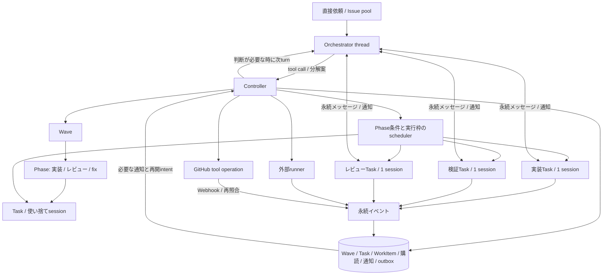

# Codex Background Wave ハーネス 実装計画

| 項目 | 内容 |
| --- | --- |
| 文書版 | 0.4 |
| 更新日 | 2026-10-22（Asia/Tokyo） |
| 状態 | レビュー反映の設計案。S/K/P/Mを別に受入。runtime未実装 |
| 要件 | [要件定義書](requirements.md) |
| 差分の根拠 | [現行実装との差分](docs/background-wave-gap-analysis.md)（基点`fd9f745`） |
| 実装順序・担当範囲・検証 | [Background Wave実行計画](docs/coding-agent/plans/active/background-wave-plan.md) |

Waveを永続的な作業単位とし、メインOrchestratorが分解・方向修正を、通常コードのcontrollerがdispatch・購読・通知・外部操作を担う。
階層はWave→Phase→Taskとし、各Taskに独立した使い捨てsession/threadを割り当てる。未完了Taskの待機中はturnを終了し、Task完了後はsessionを再利用しない。Taskは親と同じruntimeを使い、Wave呼び出しだけを禁止する。
親とTaskは永続受信箱を通じて双方向にメッセージを送り、通知から必要なturnを再開する。
PR作成等のtool callはcontrollerを経由し、関連資源の購読を自動登録する。

本書は改訂後の構成と契約を定める。
[S/K/P/Mの受入区分](requirements.md#22-受入段階と適用範囲)を使い、実接続spike（S）→新DBのWave kernel（K）→PR接続（P）→既存作業移行（M）の順に確認する。
KはIssue/WorkItem/PRなしで完成を判定できる。Pの正式承認・merge要件とMの履歴保持は全体完成まで残す。
実装済みの範囲と導入先の未確認能力は[受入検証記録](docs/acceptance.md)を原本とし、本書にある構成を実装済みとはみなさない。

## 1. 構成と責務

| 領域 | 主な配置 | 責務 |
| --- | --- | --- |
| Wave/Phase/Task・Artifact | `internal/domain/wave.go`、`internal/storage/waves.go`、`internal/storage/artifacts.go`（新設） | 元要求・版、coverage、Phaseの順序・進行条件、所属Taskと依存、既存WorkItemの関連 |
| Runtime | `internal/service/` | 状態適用、外部操作、イベント取り込み、公開・merge前の再照合 |
| Scheduler | `internal/service/scheduler.go`（新設） | ready集合、実行枠、thread/worktree/共有Git操作の予約と解放 |
| Orchestrator | `internal/service/orchestrator.go`（新設） | 元要求・通知batchをmain threadへ渡し、構造化提案を検証・採用 |
| Subscription | `internal/storage/notifications.go`、`internal/service/notifications.go`（新設） | cursor、通知、配送確認、再開理由とrunの対応 |
| Mailbox | `internal/storage/messages.go`、`internal/service/messages.go`（新設） | 親子間の宛先検証、双方向メッセージ・返信、受信箱と通知 |
| Tool gateway | `internal/service/tools.go`（新設）、`internal/codex/` | 許可済みtoolの検証、operation・購読intent、server request応答 |
| Local IPC | `internal/control/`（新設） | CLI/webhook/runnerからdaemonへ通知、状態streamの再接続 |
| 既存基盤 | `internal/worker/`、`internal/runner/`、`internal/github/`、`internal/review/`、`internal/gate/` | 継続thread、runner、GitHub連携、既存の承認・検証契約 |

新設先は所有範囲を明確にするための配置案であり、各Task内の内部構造まで固定しない。
Go、SQLite、ローカルrunner、単一ホスト・単一controllerを維持する。
実行プランは型付きの構造化出力として保存し、定義済みのPhase条件・Task依存・tool操作をcontrollerが実行する。定型遷移のたびにmain turnを起動せず、未定義の分岐や方向修正だけを親へ返す。
Claudeの生成JavaScript方式との比較は[公式資料の比較](docs/background-wave-gap-analysis.md#公式dynamic-workflows資料との比較)を参照する。本計画は任意スクリプトの実行エンジンを導入しない。
分散brokerや全threadを一つのapp-server接続に多重化する構成は導入しない。

## 2. 管理単位と状態の原本

`OrchestratorSession 1 → N Wave → N Phase → N Task`と`Task 1 → 1 Session/Thread`を基本関係とする。
Taskは一つのPhaseに所属する。親はPhaseを構成し、各Phaseの必要Taskと条件を満たした時に次Phaseを開始する。
初期のPhaseは順次進行し、Phase内では依存・実行枠を満たすTaskを並行実行する。
KではTaskのWorkItem参照を0件以上とし、調査・分析・報告のためにIssueやGit commitを捏造しない。
Phase順序とTask/成果依存を合わせて検証し、先行PhaseのTaskが後続Phaseの成果を待つ分解は拒否する。先行変更のmergeが必要な製品後続Taskは、その成果が成立した後のPhaseへ配置する。
WorkItemはWave内の成果物・候補の管理単位としてTaskと関連付け、同じWorkItemを実装・検証・レビューの複数Taskが参照できる。
WorkItemは一つの主PRに対応し、同じ候補の修正では増やさない。
部分PRの後続・分割・最終受入修正には既存のWorkItem系譜を用い、Taskから全系譜を追跡する。
直接依頼にはIssueを捏造せず、元要求のsourceを`direct`として保存する。
Issue経由はrepository ID・Issue番号・scope revisionと既存claimを維持する。

| 保存対象 | 状態の原本と主な関連 |
| --- | --- |
| Wave | 元要求、scope/plan版、適用機能、完了条件、Phase集合、budget ledgerへの参照 |
| Phase | Wave ID、順序、所属Task、開始/完了条件、結果、親による追加・方向修正の版 |
| Task | Phase ID、一つの使い捨てsession ID、親session ID、指示・criterion coverage、入力成果・前Task、依存先、WorkItem参照（0件以上）、pause/cancel、待機理由、終了結果 |
| Artifact | ID、Wave/Task・scope版、kind、内容digest・byte数、媒体型、controller内の保存参照、出所、保持状態 |
| WorkItem | 既存のPRライフサイクル、candidate、scope/policy、親最終受入・後続系譜 |
| Session / Run | 親またはTask固有のthread、一回の起動intent、turn、結果、使用量。実装/検証/レビューはTaskの指示・成果種別 |
| Message | ID、発行元session・宛先、親子binding、Wave/Task・要求の版、本文・返信先、送信・配送・処理状態 |
| Event | source ID、種別、resource、Wave/Task/WorkItem、要求の版、candidate、payload参照 |
| Subscription / Notification | 対象・種別・再開条件、購読者、cursor、通知ID、配送・処理状態 |
| Operation | 外部操作intent、tool callとの対応、資源marker、送信状態、結果不明と照合情報 |

WorkItemの品質・公開工程は`implement → verify → validate → local_review → publish/review/merge`を維持する。
親が実装・検証・レビュー・fixのPhaseを構成し、その中の別Taskへの指示で担当を分ける。
指摘は親が保存したtemplateをcontrollerが展開するか、親の例外判断により、次のfix Phaseの新Taskへ引き渡す。完了済みTaskを再開せず、更新候補の再レビューも新Taskとする。
プロダクトのPhaseはTaskを束ねる進行単位であり、既存WorkItemの`phase`とは別の型・識別子として扱う。
Phaseの状態は開始/完了条件と所属Taskから評価し、WorkItemの状態を二重転記しない。Attempt/Runは未完了Taskのturn・復旧に用い、完了Taskへの追加作業を表さない。
Waveの進捗はTask/WorkItemと最終受入から集約する。
依存は必要な成果を明示する。検証・レビューTaskは先行Taskの固定候補SHAが利用可能になれば開始でき、先行PRのmergeを待たない。
製品実装の後続で先行変更を取り込む場合はmerge・最終受入を待ち、未merge branchのstackを暗黙に作らない。
レビューの差し戻しは過去Taskへ循環edgeを加える処理にせず、候補SHA・round・指摘を入力とする新しいfix Phase/Taskにする。
再レビューは更新候補を入力とする新Phase/Taskを作り、旧SHAの判定は失効させる。
Task Aのレビュー中でも、独立Task Bは実行できる。
次Phaseの開始は保存したPhase完了条件に従う。失敗・cancel・終了したTask数だけでPhaseを成功にしない。

Waveの`completed`には、対象criterionと不変成果の対応、独立評価、未解決指摘・残作業の不存在が必要である。
製品変更を含むWaveは、さらに関連WorkItemのmergeと親最終受入を必要とする。Cloud承認が未成立なら該当製品Waveは外部待機・保留とする。汎用Waveの完了にGitHub承認を要求しない。

### 2.1 Phase条件・Task終端・定型反復

初期schemaは`completion: {"kind": "all_success", "required_task_ids": [...]}`を受理する。
集合は空にせず、初期は当該Phase所属Taskの全件と一致させる。全必須Taskが`completed`で、現在のscope/plan bindingに対して結果の構造・参照が有効ならPhaseの実行完了とする。
`completed`は妥当な成果を返した意味であり、レビューで指摘がないことや製品の検証成功とは別である。品質の判定は成果の`verdict`とcriterion・検証・review gateで行い、Wave完了へ直結させない。
quorum/any-success、任意predicate・暗黙skip、任意の動的fan-outは初期非対応としてschemaで拒否する。

| Task状態 | 意味と次の処理 |
| --- | --- |
| `ready` | Phase条件・依存・空き枠を待つ。未起動 |
| `running` | runが起動中/実行中。unknown-startも照合まで枠を保持 |
| `waiting` | 待機条件・通知cursorを保存し、turn正常終了とprocess停止を確認済み |
| `blocked` | 入力・認証・予算・run失敗・不明起動等の理由付き保留。未完了だが無条件再開はしない |
| `completed` | 正常終了と妥当な構造化成果を適用済み。終端で再開不可 |
| `failed` | 成果契約違反や明示された回復不能を記録した終端。追加作業は新Task |
| `canceled` | operatorによる終端。送信済み操作の結果だけ追跡する |

runのtimeout/failed/interruptedは成功にせず、Taskをまず`blocked`にする。
分類済みの一時的な実行環境障害だけ、旧process停止・同一scope・予算を照合して同一未完了Task/threadの次Attemptを最大1回自動実行できる。利用制限・仕様不明・token超過は自動retryしない。
上限後は理由と必要操作を保存し、明示retryも累積Attempt上限に従う。thread履歴が復旧不能なら旧Taskを`failed`とし、新Task/sessionへ成果・差分を渡す。
レビュー指摘やテスト失敗を正常に報告できたTaskは`completed`で、製品/テストのfixは新Taskへ渡す。これを環境retryとして同じTaskへ戻さない。

Phaseの初期失敗policyは`drain_and_block`に固定する。必須Taskのfailed/canceled/blockedまたはrunのunknownがあれば次Phaseを開始せず、他の未起動Taskの開始を止め、実行済みTaskと外部操作の結果は回収する。当該blocked Taskの認可済み復旧Attemptは許可し、解消後にPhase条件を再評価する。
自動で成功扱いのskipや無関係なcancelを行わない。回復不能なTaskの置換は親の新plan revisionで必須IDとcoverageを再検証し、旧Taskは旧版の履歴として保持する。

親は初回planで`fix_review`という有界templateを保存できる。入力は対象artifact/candidate、構造化した指摘ID・分類・期待値根拠とし、成功時は次Phaseへ、`artifact_defect`/`implementation_defect`/`test_defect`なら対応fix Taskへ進む。製品変更では必要な独立検証・runnerを挟み、その後に新review Taskを作る。
一巡の同じ候補の指摘は一つのbatchとして扱い、固定した担当別templateを展開する。分類不能・仕様変更・template外は親の再計画へ返す。ローカルreview成功をGitHubのAPPROVEDへ変換しない。
展開は親が採用済みplanで許した構造変更の実行であり、Task自身のWave呼び出しや自由なTask生成ではない。
各反復で新Phase/Task/sessionを発行し、古いTaskへの循環依存を加えない。fixによる新成果digest/SHAで必要gateを失効させる。

scope revisionは要求変更、plan revisionは実行構造変更を表す。展開keyはtemplate ID・反復番号・入力成果digest・指摘batch IDから固定し、plan版更新・Task生成・coverage・予算予約・通知intentを同じtransactionで保存する。
同じkeyの再適用は既存結果へ関連付ける。前版の未変更Task成果を引き継ぐ場合は、そのTask・scope/policy・入力digest・結果IDが一致するbindingを明示保存する。scope変更時は旧成果・承認を無条件流用しない。

通常の成功・template内の反復でmainを起動する回数は0。分類不能等の例外でだけ、理由と予算を保存してmainを再開する。
Phase順次barrierは初期schemaの一方式とする。Taskの成果依存をPhase番号と別fieldで保存し、将来pipelineを追加する場合はschema版を変えて検証する。初期から複数Phaseを重ねて実行しない。

### 2.2 汎用成果と参照渡し

共通結果は`schema_version / wave_id / phase_id / task_id / scope_revision / plan_revision / outcome / artifacts / criterion_results / work_item_refs / remaining / blockers`を持つ。
`criterion_results`はscope内のcriterion ID・成果/証拠参照・`claimed / unverified`・根拠を持つ。claim自体で合格にせず、独立評価と必要な実行証拠を対応させる。
`work_item_refs`は空でもよい。outcomeは`result / waiting / blocked`を区別し、`waiting`はTaskの終端成果とせず購読・再開情報を検査する。
製品変更ではWorkItem/Candidate、検証ではplan/evidence、レビューでは対象digest/SHA・指摘ID・根拠・`clean / findings / inconclusive`を追加する識別可能なschemaにする。
`clean`はレビュー観点の合格だけを表し、全必須criterionの成立や外部承認を代用しない。判定不能は親判断/保留へ返す。

Artifactはcontroller発行ID、SHA-256、byte数、content type、元Task・scope版・入力成果、`task / repository / external`の出所を持つ。
内容保存とmanifest確定後に結果へ関連付け、不変にする。workerのpathや申告digestをそのまま信頼せず、許可した成果をcontrollerが取り込み、正規化path・symlink逸脱・実byte数・digest・読み取り権限を検査する。
inlineはUTF-8で16 KiB、Artifact一件は8 MiB、Wave合計は256 MiBを提案既定値とする。Task間はArtifact IDを渡し、必要な抜粋だけを入力へ含める。main入力全体は64 KiBを上限とし、超える場合はmanifestと参照へ縮約する。
modelへcontrollerのprivate pathを公開しない。kernelの参照取得toolを通し、当該sessionのWave/Task/scopeへ許可されたIDだけを返す。
保持は終端から30日を既定とし、参照する未完了Taskがある間はGCしない。expired/欠落/digest不一致は不明として必要Taskを保留し、空の成果や過去の完了主張で成功にしない。
製品コード・テストの正式成果は従来どおりcommit SHAで固定する。汎用Artifactを使ってGitのCandidate検証を迂回しない。

## 3. セッションとtool call

### 3.1 担当threadの継続

メインは複数Waveを扱えるOrchestratorSessionのthreadを持つ。
各Taskを新しい独立session/threadで開始し、そのTaskが完了するまでの待機・復旧だけに同じthreadを使う。
Task完了後はsessionを再利用せず、独立検証・レビュー・fix・再レビューは親が対応Phaseに新Taskを作り、共通session driverで新sessionを開始する。
使い捨ては論理的な再利用禁止を意味し、Codexの`ephemeral: true`による非永続threadを要求しない。実行中の復旧と監査に必要な履歴は保持し、完了後にpolicyに従ってGCする。
レビューTaskには元要求・固定候補差分・検証証拠と読み取り専用の作業指示を渡す。これはTaskのscope/policyであり、レビュー専用の縮小session runtimeを作る意味ではない。

既存の`Session/Run`とunknown-start照合を共通session driverへ整理する。
threadの同時turnは禁止する。通知は実行中turnを勝手に中断せず、次の安全な開始境界へまとめる。
運用者のpause/cancelは実行中断と区別し、新規入力と通知の優先順位を記録する。
新Taskの入力には元要求・scope/policy版・対象候補・前Taskの構造化成果・指摘・実行証拠・残作業を渡す。過去thread全体の再投入やTask間のcache hitを必須にしない。
cacheの維持を目的とするkeepaliveやプロセス常駐は要求しない。

### 3.2 tool operationの境界

親とTaskは共通session runtime・tool gatewayを使う。初期toolはWave呼び出し、Taskへの指示、待機条件登録、状態取得、親子メッセージ、PR作成・更新、レビュー依頼とする。
Waveの作成・実行・再分割等、入れ子Waveを生む呼び出しは親だけに公開し、Taskには公開しない。controllerも実際のsession/親子bindingから認可し、非公開tool名・別名・中継要求を拒否する。
Taskは必要な再分割・独立レビューを親へメッセージで依頼できる。Wave/Phase/Taskの構造変更は親の管理操作とし、メッセージ本文だけでは適用しない。
名称・入力・応答はTask_0の成立確認を経てTask_1で版付きschemaとして固定する。KではWave・待機・状態・成果参照・親子messageのgatewayを提供し、PでPR操作handlerを追加する。
直接GitHubを書ける資格情報はモデルの実行環境へ渡さない。
モデルはtoolを選び、controllerがそのsessionに許されたWave・Task・repository・candidate・scope・予算を検証して実行する。
親子に共通のscope・sandbox・予算・検証・承認policyを適用する。Taskであることだけを理由にPR作成や親子メッセージ等の共通toolを剥奪せず、個々の要求がscope/policyを満たすかを検証する。

Codex側は採用版の実験的dynamic tool契約を明示的にopt-inし、`item/tool/call`を許可済みgatewayへ配送する。
その他の承認・入力要求をtool実行と誤認しない。
接続内のRPC応答とserver requestは一つのreaderで振り分け、tool処理が同じreader待ちでdeadlockしない構成とする。

長い外部操作のtool応答は保存済み`operation_id`と`subscription_id`を返せる契約にし、受付を完了と表示しない。
完了は後続イベントで配送する。
分解・方向修正の構造化提案も、coverage・依存循環・権限・要求の版を検証してtransactionで採用する。
自然文の「完了」やtoolの自己申告でgateを成立させない。

## 4. 自動購読と通知再開

### 4.1 PR操作に伴う自動購読

1. tool callのsession/thread/turn/call IDと、Wave/Task/WorkItem・候補・要求の版を確認する。
2. 外部操作intent、再照合marker、未解決資源を対象とする購読intentを同じtransactionへ保存する。
3. controllerだけが既存adapter経由で外部操作を送信する。
4. 応答またはmarker照合からPR ID等を確定し、操作結果・資源binding・購読を同じtransactionで確定する。
5. 操作前に記録したイベント境界以降のraw deliveryと資源の最新状態を照合し、購読確定までの更新を回収する。
6. tool応答にoperation・資源・購読IDと受付/完了/不明の区別を返す。再送は既存の結果へ関連付ける。

購読はPRのissue comment、inline review comment、review、review dismissal、reaction、checks/status、close/merge等を対象にする。
GitHubが対象イベントを配信しない資源・更新は通常コードの差分照合で補う。
Webhook署名、delivery重複排除、pagination、編集/削除・取消、権限不足、rate limitを扱う。
全更新の完全な履歴が取得できない場合は差分の不明範囲を記録し、観測していないコメント等を生成しない。

既存のcontrollerによるPR操作も同じgatewayのoperation作成処理を使い、モデルtoolと二重の公開経路を作らない。
自動購読先は発行元Taskとその待機sessionとし、mainにはpolicyが必要とする集約通知を渡す。
コメント・リアクションはデータであり、肯定的な反応をAPPROVEDへ変換しない。

### 4.2 通知からの再開

イベント適用と通知intentを同じtransactionに保存する。
購読を作る際は保存済みterminal stateとイベント境界も確認し、subscribe-before/after-completionの両方で同じ結果を取得できるようにする。

通知は少なくとも`pending → bound_to_run → applied`を区別する。
clientの配送ackだけでは判断済みにせず、再開intentに通知ID集合・要求の版・再開理由を固定し、対応runの結果を適用してから処理済みにする。
クラッシュ時はそのrunへ再関連付けし、新しいturnを無条件に開始しない。
同一threadの通知群は集約し、実行枠・入力待ち・pause/cancelを再評価してから起動する。

待機条件はDBへ保存してからturnを正常終了する。
その間に届いた通知は保持し、終了を確認した後でのみ次turnを開始する。
新候補・方向修正後の旧通知は履歴に残すが、新版のdispatch理由に自動変換しない。

### 4.3 親子間メッセージと受信箱

親は`send_message(task_id, body, reply_to)`、Taskは`send_message(parent, body, reply_to)`を共通gatewayから呼ぶ。
引数に指定された発行元を信用せず、呼び出したsessionのbindingからsenderを確定する。
宛先は同じ親子関係に限定し、別Wave・兄弟Task・無関係なsessionを指定した転送を拒否する。
Task作成時に親子双方の受信購読を登録し、保存済みメッセージとの競合も通知基盤で回収する。

message、受信箱entry、通知intentを同じtransactionで保存してから、message IDと受付状態を返す。
外部comment等からの情報は元resource ID・digest/SHA・要求版・出所種別を参照できる形で渡す。Taskによる要約があっても出所ラベルを権限に変換しない。
親が再計画を提案する場合も元要求・scope・tool認可・構造上限を再検査する。親への中継だけではscope/policy緩和・別Wave宛先・入れ子Wave生成を許可しない。
message IDとtool callの対応で再送を照合し、`reply_to`は同じ親子間の既存messageを参照する。
受信側が実行中なら受信箱へ保持し、turn終了確認後に未処理messageをbatchで入力する。待機中なら同じthreadを次turnで再開する。
一方のthreadが動き続けている間ももう一方の送信toolを待たせず、質問の回答待ちは受信購読を保存してturnを終了する。

メッセージの配送ack、runへの関連付け、判断の適用・返信を分ける。
pauseは自動再開を抑止して未処理messageを保持し、cancel/終端は保存・通知しても自動再開しない。
完了後の追加指示は親が新Taskへ引き渡し、元Taskと成果を関連付ける。完了済みTaskを新attemptとして再開しない。
旧版のmessageは履歴に残し、自動で方向修正や完了を適用しない。

### 4.4 main文脈の構成と復旧

通常は同一main threadで複数Waveを扱う。各入力snapshotに対象Wave・scope/plan版、元要求、現在のPhase/Task、必要な不変成果参照、通知IDと適用状態、残予算を含め、Waveごとの境界を明示する。
snapshot ID/digestと通知→run bindingをDBに保存し、履歴・cacheの有無によらず同じ判断入力を構成する。古いWaveの会話で現在のscope/policyを上書きしない。
64 KiBを超える入力はcontroller保存の構造化manifestと参照に分ける。要約文だけを状態の原本にしない。compactionに依存せず、取得できる履歴と現在のDB事実を照合する。

mainは一thread当たり8 turnを提案上限とし、次の起動理由が生じた安全境界で旧process停止・snapshot保存後に新main threadへbindingを更新する。論理Orchestrator session IDとWave/予算/通知履歴は維持し、更新自体のためのLLM呼び出しは行わない。
取得可能なcontext使用量と導入modelの信頼されたsoft limitでも早期更新できるが、threadの累積課金tokenをcontext長と混同しない。容量情報がなければturn上限を使い、context超過エラー時も未適用runを照合してから復旧する。
main履歴が利用不能なら、未知turn/外部操作と旧processを照合してdispatchを止める。停止を確認した後、旧thread/run/snapshotと新threadのbindingを監査付きで保存して復旧する。
既存runへ関連付いた通知を無条件に新turnへ再送せず、未適用入力だけを再構成する。旧runの適用状態が不明なら保留する。
これは継続mainの障害復旧であり、完了Taskのsession再利用ではない。Taskのthreadを復旧できない場合は§2.1の新Task引き渡しとする。

### 4.5 操作の優先と実行中turn

| 操作 | 新規dispatchと実行中の扱い |
| --- | --- |
| 通常message/notification | 実行中は受信箱へ保持し、正常終了後の安全な境界でbatchする |
| pause | Wave/Taskの新規turnを止め、未処理入力を保持する。実行中を暗黙interruptしない |
| 方向修正（CLIのsteer） | 新規dispatchを止め、実行中runの結果を旧版として保存してからscope/plan変更を適用する。直ちに止めたい場合は別の明示interruptを使う |
| cancel | 対象を終端化し未送信操作を拒否する。実行中を自動再開せず、送信済み操作とrun結果は追跡する |
| 明示interrupt | 指定runの停止を要求し、停止確認まで枠を保持する。結果は成功とせず未完了Taskの保留へ進める |

送信時は最新のcancel・hold・pause・版・権限を再評価し、禁止条件を優先する。Wave/TaskとWorkItemの禁止フラグのいずれかが成立した対象操作を送らない。
CLIの`wave steer`はハーネスの版付き操作であり、app-serverの`turn/steer`へ同一視しない。初期は実行中への自動steerを採用しない。追加する場合は採用版での契約・未知応答・旧版結果の扱いを別途検証する。

## 5. イベント配送と並行scheduler

単一controllerが管理するローカルUnix domain socketをIPCの通常経路とする。
socketはcontrollerのprivate root内に置き、workerから見えない権限を維持する。
CLIとwebhookはDBへの永続記録後にdaemonへwake hintを送る。
runnerは結果fileを原子的に保存した後、最小のjob IDを通知する。controllerは保存したintentとfileを照合し、runnerからの自己申告だけで成功にしない。
agent completionは同一processのイベント経路へ渡す。

IPCはwake hintと読み取りstreamであり、状態の原本にしない。
通知失敗・daemon不在でも保存済み記録は残し、起動時および低頻度reconciliationで回収する。
worker隔離からprivate socketへ到達させず、信頼された`_runner`ラッパーが結果保存後にjob IDだけの完了hintを送る。
検証コマンドの子processは既存launcherで隔離し、socket・通知設定・controllerの一般操作権限を渡さない。
`_runner`のhintは再照合の契機に限定し、operationやgateの更新命令として扱わない。

schedulerはイベントでready集合を再評価し、LLM・runner・進行中PRの枠をtransactionで予約する。
同一thread/worktreeと共有repositoryのbranch作成・commit・fetch/push等、競合するGit操作をWave境界をまたいで排他する。
別worktreeでも同じファイルを変更するPRは競合し得る。先行merge後のbase更新はcontrollerが通常のGit mergeを試し、競合は旧候補・差分・指摘を付けた新fix Task/sessionへ返す。
候補更新後は検証/レビューを取り直す。既存PRの履歴rewriteや未merge branchのstackを暗黙に使わない。
待機はLLM枠を解放するが、停止確認のないprocessや不明な起動の枠は再照合まで解放しない。
公平なready順序、pause/cancel、期限・予算超過、終了結果を保存して別Taskの進行を止めない。

tokenはWave/Taskの累積ledgerへrun ID単位で計上し、既存WorkItemの使用量を二重加算しない。
分割・部分PR・最終受入修正も同じWave予算を引き継ぐ。
観測tokenの遅延による上限超過可能性は明示し、次turnの起動を停止する。

### 5.1 上限・既定値・計測

以下はv0.4で新runtimeに採用する**提案既定値**であり、現行バイナリに実装済みではない。信頼された設定に保存し、採用版をWaveへ固定する。

| 項目 | 新規設定の既定値 | 計数・適用範囲 |
| --- | --- | --- |
| 同時Wave / turn / runner / PR / Cloud review | 4 / 2 / 1 / 1 / 1 | controller全体。旧設定の移行はすべて直列値1を引き継ぐ |
| Phase総数 / Task総数 | 16 / 64 | Wave累積。failed/canceled/旧版も含め、再計画で減算しない |
| 親turn数 / 再計画数 | 16 / 8 | Wave累積。初回分解・終了説明もturn数に含む。初回planは再計画数に含めない |
| main thread当たりturn数 | 8 | 安全境界でsnapshotから新main threadへ更新。Wave予算は継続 |
| fix/review反復 / TaskのAttempt総数 | 3 / 2 | Waveの定型fix反復、各Taskの初回+追加1回。復旧のreadだけはAttemptを増やさない |
| Wave token / 壁時計期限 | 観測1,000,000 token / 作成から48時間 | mainと全Taskで共有。pause・外部待機も期限に含む |
| 一turn / review待機 / profile | 1,800 / 3,600 / 900秒 | 既存初期設定を基点とする。profileは信頼された定義ごとに固定 |
| validation job / runner追加retry / 同一候補review依頼 | 100 / 1 / 2 | Wave集約で二重計上せず、WorkItemの既存上限も満たす |
| Issue分割深さ / 子数 | 2 / 8 | 既存の系譜を引き継ぐ。Taskからの子Waveは常に禁止 |
| main入力 / inline / Artifact一件 / Wave成果合計 | 64 KiB / 16 KiB / 8 MiB / 256 MiB | UTF-8 byte数。参照manifestも入力上限に含める |
| ログ保持 / controller成果容量 / 回復照合周期 | 30日 / 1 GiB / 60秒 | 現行initを基点に容量対象をjob/log/Artifactへ拡張。未完了Taskが参照する証拠はGCしない |

main tokenはrunの増分を入力snapshotの対象Waveへ一度だけ計上する。複数Waveの共有runは等分し、整数の余りをWave ID昇順で配賦する。対象集合・run増分・配賦額を保存し、合計を元の増分に一致させる。thread累積値をWaveごとに全量加算しない。取得不能はunknownを保持する。
構造追加と枠・予算を同じtransactionで予約する。成果容量はWave別とcontroller合計で取り込み前に予約し、上限時は参照中の証拠を削除せず新しい取り込み/実行を保留する。残予算が不足する次runを拒否し、観測token遅延による超過可能性を表示する。既知の構造数・時間・容量の上限はtoken取得不能でも適用する。
期限到達は`blocked: deadline_exceeded`として新規開始を止め、実行中の停止要求と停止確認、送信済み操作の追跡を行う。期限変更は理由付きのtrusted operator操作とし、履歴・累積予算をリセットしない。

待機条件を保存してturnを終了したらapp-serverとその子processを停止し、停止確認後に枠を返す。履歴と購読はDB/Codexの永続保存へ残し、再開時にprocessを起動する。
mainを含むapp-server数は同時turn上限以下に保つ。RSS、cold start、停止所要時間、未知process数を記録し、ハードウェアに依存するメモリ上限値を実測前に保証しない。
参照負荷試験は独立Task 2件・空き枠あり・外部I/O stub・通知100件以上とし、通知保存→再開intent予約のp95 1秒以内をSHOULD目標とする。process/model/外部待ち時間は分けて報告する。
`wave create`は採用plan・最大Task/Phase/Attempt・token上限・既知使用量/不明範囲を表示する。dry-run/見積もり表示はSHOULD、通貨換算は料金設定がある場合だけMAYとする。開始ごとの新たな人手承認を既定で追加しない。

## 6. 永続化と移行

新しいschema versionを導入し、Wave/Phase/Task/session binding、message/mailbox、subscription、notification、wake intent、resource binding、予算予約・計上を保存する。
既存`records`をすべて専用tableへ移す整理は今回の必須条件にしない。
既存のID、role_thread key、candidate、outbox、不明操作、scope/policyと親最終受入は保持する。

Kは既存rootと重ならない新しい空DBで検証する。旧DBを新規DBとして初期化せず、未対応schemaを拒否する。Mの実装・検証前は既存作業を新runtimeへ取り込まない。
運用DBの存在・所有者・unknown処理を導入前に確認する。新規導入で移行対象がなければMのfixture検証は行い、実移行だけnot_applicableと記録する。旧データ削除や全利用者へのfresh-start強制を意味しない。
移行はcontroller停止・未知process照合後、SQLiteの整合したbackupを作って実行する。
既存の一つの元要求のsplit/continuation/repair系譜を一つのWaveへまとめ、保存済み状態からPhaseとTaskを関連付ける。
既存thread ID・履歴・role_thread keyは監査用に保持し、実行中のthreadだけを対応する移行Taskのsessionへ結び付ける。
終了済みのrole threadを後続Taskへ再利用せず、未開始の仕事・fixは新しいPhase/Task/sessionへ引き渡す。
移行bindingには再実行用の安定keyを保存し、未知のturnは再照合完了まで再開しない。
移行が要件上のcoverageを復元できなければ、その作業だけを理由付き保留にし、範囲を推測しない。
version 1のtrusted configは明示的な更新コマンドで新versionへ変換し、既存policy snapshotを上書きしない。
新しい並行上限は旧設定の直列値を引き継ぎ、導入者が2以上に設定して並行性を有効にする。
旧CLIによるWorkItem参照・操作は維持し、Task/Waveのpause等との優先関係を検証する。

新バイナリは未対応schema versionを拒否する。移行後のDBを旧バイナリへ渡さないことは起動・切戻し手順の制約とし、旧バイナリ自身が新versionを拒否できるとは仮定しない。
失敗時は新dispatchを停止し、送信済み外部操作を照合した上でbackupを復元する。
移行後の書き込みがあるDBを単に旧版で開くrollbackはしない。

## 7. 操作面と実装順序

最初の操作面はローカルCLIとtool契約とする。
`wave create`（request fileとOrchestrator session）、`wave list/inspect`、`wave pause/resume/cancel`、`wave steer`（版付き方向修正）、cursor付き`wave watch`を追加する。
これらは実装予定のコマンドであり、現行バイナリでは使用できない。
一覧はTaskの工程・担当・試行・待機理由・成果リンク・使用量へ辿れる構造化出力を提供する。
外部チャット製品への接続や画面再現は別のhost adapterとし、初期完成の条件にしない。

[実行計画](docs/coding-agent/plans/active/background-wave-plan.md)は次の順序で進める。

1. S / Task_0: 無害なdynamic tool一件の実往復、正常終了、新processで同一未完了threadの再開。未成立なら依存する実装を保留する。
2. K / Task_1〜7: 共通session/tool認可、Wave/Task/汎用成果、schema基盤、購読・message、scheduler、event loop、mainと独立レビュー。
3. K / Task_9〜10: 新DBのCLI・汎用Wave・並行性・template反復・障害注入を統合してKを判定する。
4. P / Task_8・11: 既存PR工程をgatewayへ接続し、自動購読・複数Wave/PR・base競合と正式gateを確認する。
5. M / Task_12: v1 DB/configをfixtureで移行し、実導入先の有無と切替を記録する。
6. Task_13: P/Mを含む全体回帰と限定実接続。CloudがunknownならK合格、P/全体未達を別に表示する。

各Taskは小さなPRとしてレビューできる単位とし、依存が満たされ所有範囲が分かれるTaskだけを並行実装する。
AT-001〜030の品質・外部操作を回帰検証する。AT-009は同じthreadのfixから新fix Taskへの引き渡しへ意図的に改訂し、AT-031〜059を適用段階ごとに検証する。K/P/Mの合否と未実行を別欄で記録する。
DB・clock・process・外部APIはfakeで順序とクラッシュを決定的に再現し、並行境界には`go test -race`を加える。
実サービスはdynamic tool往復、thread再開、PR資源購読の代表経路に絞り、未成立のCloud承認をfakeの成功で補わない。

## 8. 外部契約と未確認事項

Codexは`0.163.0`を維持し、必要な実験的tool schemaを同じバイナリから生成して固定する。
[公式App Server資料](https://learn.chatgpt.com/docs/app-server)（2026-10-22参照）のtool呼び出し・thread継続契約を使う。
Waveの購読・通知・再開は独自runtimeの責務とする。
実際のmodel・認証・隔離環境でのdynamic tool往復と同一thread再開は未確認であり、Task_0の先行spikeで確認する。
最低限のspikeは無害なtool・controller応答・正常終了・別processでの再開・call/turn対応の証拠を保存する。schemaの存在と実推論を別の能力として記録する。
不成立なら依存工程を保留する。`outputSchema`の要求配列をturn終了後に適用する方式は同期toolと待機境界が異なるため、初期fallbackとして自動有効化しない。採る場合は契約版・AT・制約を再計画する。

GitHubの正式承認・CIとSHA・rules/bypassの未確認事項は[既存の接続証拠](docs/issue20-live-connections.md)を引き継ぐ。
これらはPの自動merge・製品Wave・全体完成を制約する。S成立後のKの実装・受入は独立して進められる。
