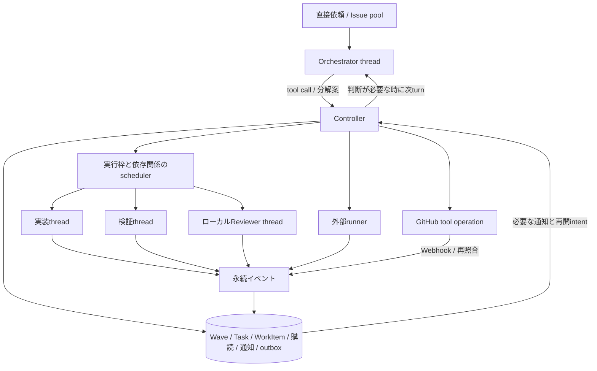

# Codex Background Wave ハーネス 実装計画

| 項目 | 内容 |
| --- | --- |
| 文書版 | 0.2 |
| 更新日 | 2026-10-22（Asia/Tokyo） |
| 状態 | 設計案。実装着手の承認前 |
| 要件 | [要件定義書](requirements.md) |
| 差分の根拠 | [現行実装との差分](docs/background-wave-gap-analysis.md)（基点`fd9f745`） |
| 実装順序・担当範囲・検証 | [Background Wave実行計画](docs/coding-agent/plans/active/background-wave-plan.md) |

Waveを永続的な作業単位とし、メインOrchestratorが分解・方向修正を、通常コードのcontrollerがdispatch・購読・通知・外部操作を担う。
担当threadを保持し、待機中はturnを終了する。
PR作成等のtool callはcontrollerを経由し、関連資源の購読を自動登録する。

本書は改訂後の構成と契約を定める。
実装済みの範囲と導入先の未確認能力は[受入検証記録](docs/acceptance.md)を原本とし、本書にある構成を実装済みとはみなさない。

## 1. 構成と責務

| 領域 | 主な配置 | 責務 |
| --- | --- | --- |
| Wave/Task | `internal/domain/wave.go`、`internal/storage/waves.go`（新設） | 元要求・版、coverage、Task DAG、完了条件と既存WorkItemの関連 |
| Runtime | `internal/service/` | 状態適用、外部操作、イベント取り込み、公開・merge前の再照合 |
| Scheduler | `internal/service/scheduler.go`（新設） | ready集合、実行枠、thread/worktree/共有Git操作の予約と解放 |
| Orchestrator | `internal/service/orchestrator.go`（新設） | 元要求・通知batchをmain threadへ渡し、構造化提案を検証・採用 |
| Subscription | `internal/storage/notifications.go`、`internal/service/notifications.go`（新設） | cursor、通知、配送確認、再開理由とrunの対応 |
| Tool gateway | `internal/service/tools.go`（新設）、`internal/codex/` | 許可済みtoolの検証、operation・購読intent、server request応答 |
| Local IPC | `internal/control/`（新設） | CLI/webhook/runnerからdaemonへ通知、状態streamの再接続 |
| 既存基盤 | `internal/worker/`、`internal/runner/`、`internal/github/`、`internal/review/`、`internal/gate/` | 継続thread、runner、GitHub連携、既存の承認・検証契約 |

新設先は所有範囲を明確にするための配置案であり、各Task内の内部構造まで固定しない。
Go、SQLite、ローカルrunner、単一ホスト・単一controllerを維持する。
分散brokerや全threadを一つのapp-server接続に多重化する構成は導入しない。

## 2. 管理単位と状態の原本

`OrchestratorSession 1 → N Wave → N Task → N WorkItem`を基本関係とする。
WorkItemは一つの主PRに対応し、同じ候補の修正では増やさない。
部分PRの後続・分割・最終受入修正には既存のWorkItem系譜を用い、Taskから全系譜を追跡する。
直接依頼にはIssueを捏造せず、元要求のsourceを`direct`として保存する。
Issue経由はrepository ID・Issue番号・scope revisionと既存claimを維持する。

| 保存対象 | 状態の原本と主な関連 |
| --- | --- |
| Wave | 元要求、要求の版、完了条件、Task集合、budget ledgerへの参照 |
| Task | criterion coverage、依存先と必要成果の版、WorkItem関連、pause/cancel、待機理由 |
| WorkItem | 既存のPRライフサイクル、candidate、scope/policy、親最終受入・後続系譜 |
| Session / Run | `orchestrator`またはWorkItem×roleのthread、一回の起動intent、turn、結果、使用量 |
| Event | source ID、種別、resource、Wave/Task/WorkItem、要求の版、candidate、payload参照 |
| Subscription / Notification | 対象・種別・再開条件、購読者、cursor、通知ID、配送・処理状態 |
| Operation | 外部操作intent、tool callとの対応、資源marker、送信状態、結果不明と照合情報 |

Taskの工程は`implement → verify → validate → local_review → publish/review/merge`とし、指摘は適切な担当へ戻す。
PhaseとAttemptはrunの表示・追跡に使い、既存WorkItemのphaseを別の独立state machineへ二重転記しない。
Waveの進捗はTask/WorkItemと最終受入から集約する。
依存は初期には先行Taskのmerge・最終受入済み成果を要求し、未merge branchのstackを暗黙に作らない。
Task Aのレビュー中でも、独立Task Bは実行できる。
同じWaveの全実装終了を待つ一律barrierは設けない。

Waveの`completed`には、対象criterionの充足、必要なWorkItemのmergeと最終受入、残作業の不存在が必要である。
ローカル実装・レビューが終わってもCloud承認が未成立なら、外部待機・保留として理由を表示する。

## 3. セッションとtool call

### 3.1 担当threadの継続

メインは複数Waveを扱えるOrchestratorSessionのthreadを持つ。
WorkItemごとに実装・検証・ローカルレビューthreadを保持し、fixは同じ実装threadの次turnとして開始する。
Reviewerには元要求・固定候補差分・検証証拠を渡し、読み取り専用とする。

既存の`Session/Run`とunknown-start照合を共通session driverへ整理する。
threadの同時turnは禁止する。通知は実行中turnを勝手に中断せず、次の安全な開始境界へまとめる。
運用者のpause/cancelは実行中断と区別し、新規入力と通知の優先順位を記録する。
cacheの維持を目的とするkeepaliveやプロセス常駐は要求しない。

### 3.2 tool operationの境界

Orchestratorに公開する初期toolはWave作成・更新、Taskへの指示、待機条件登録、状態取得、PR作成・更新、レビュー依頼とする。
名称・入力・応答はTask_1で版付きschemaとして固定する。
直接GitHubを書ける資格情報はモデルの実行環境へ渡さない。
モデルはtoolを選び、controllerがそのsessionに許されたWave・Task・repository・candidate・scope・予算を検証して実行する。
workerには役割に必要なtoolだけを公開する。

Codex側は採用版の実験的dynamic tool契約を明示的にopt-inし、`item/tool/call`を許可済みgatewayへ配送する。
その他の承認・入力要求をtool実行と誤認しない。
接続内のRPC応答とserver requestは一つのreaderで振り分け、tool処理が同じreader待ちでdeadlockしない構成とする。

長い外部操作のtool応答は保存済み`operation_id`と`subscription_id`を返せる契約にし、受付を完了と表示しない。
完了は後続イベントで配送する。
分解・方向修正の構造化提案も、coverage・依存循環・権限・要求の版を検証してtransactionで採用する。
自然文の「完了」やtoolの自己申告でgateを成立させない。

## 4. 自動購読と通知再開

### 4.1 PR操作に伴う自動購読

1. tool callのsession/thread/turn/call IDと、Wave/Task/WorkItem・候補・要求の版を確認する。
2. 外部操作intent、再照合marker、未解決資源を対象とする購読intentを同じtransactionへ保存する。
3. controllerだけが既存adapter経由で外部操作を送信する。
4. 応答またはmarker照合からPR ID等を確定し、操作結果・資源binding・購読を同じtransactionで確定する。
5. 操作前に記録したイベント境界以降のraw deliveryと資源の最新状態を照合し、購読確定までの更新を回収する。
6. tool応答にoperation・資源・購読IDと受付/完了/不明の区別を返す。再送は既存の結果へ関連付ける。

購読はPRのissue comment、inline review comment、review、review dismissal、reaction、checks/status、close/merge等を対象にする。
GitHubが対象イベントを配信しない資源・更新は通常コードの差分照合で補う。
Webhook署名、delivery重複排除、pagination、編集/削除・取消、権限不足、rate limitを扱う。
全更新の完全な履歴が取得できない場合は差分の不明範囲を記録し、観測していないコメント等を生成しない。

既存のcontrollerによるPR操作も同じgatewayのoperation作成処理を使い、モデルtoolと二重の公開経路を作らない。
自動購読先は発行元Taskとその待機sessionとし、mainにはpolicyが必要とする集約通知を渡す。
コメント・リアクションはデータであり、肯定的な反応をAPPROVEDへ変換しない。

### 4.2 通知からの再開

イベント適用と通知intentを同じtransactionに保存する。
購読を作る際は保存済みterminal stateとイベント境界も確認し、subscribe-before/after-completionの両方で同じ結果を取得できるようにする。

通知は少なくとも`pending → bound_to_run → applied`を区別する。
clientの配送ackだけでは判断済みにせず、再開intentに通知ID集合・要求の版・再開理由を固定し、対応runの結果を適用してから処理済みにする。
クラッシュ時はそのrunへ再関連付けし、新しいturnを無条件に開始しない。
同一threadの通知群は集約し、実行枠・入力待ち・pause/cancelを再評価してから起動する。

待機条件はDBへ保存してからturnを正常終了する。
その間に届いた通知は保持し、終了を確認した後でのみ次turnを開始する。
新候補・方向修正後の旧通知は履歴に残すが、新版のdispatch理由に自動変換しない。

## 5. イベント配送と並行scheduler

単一controllerが管理するローカルUnix domain socketをIPCの通常経路とする。
socketはcontrollerのprivate root内に置き、workerから見えない権限を維持する。
CLIとwebhookはDBへの永続記録後にdaemonへwake hintを送る。
runnerは結果fileを原子的に保存した後、最小のjob IDを通知する。controllerは保存したintentとfileを照合し、runnerからの自己申告だけで成功にしない。
agent completionは同一processのイベント経路へ渡す。

IPCはwake hintと読み取りstreamであり、状態の原本にしない。
通知失敗・daemon不在でも保存済み記録は残し、起動時および低頻度reconciliationで回収する。
worker隔離からprivate socketへ到達させず、信頼された`_runner`ラッパーが結果保存後にjob IDだけの完了hintを送る。
検証コマンドの子processは既存launcherで隔離し、socket・通知設定・controllerの一般操作権限を渡さない。
`_runner`のhintは再照合の契機に限定し、operationやgateの更新命令として扱わない。

schedulerはイベントでready集合を再評価し、LLM・runner・進行中PRの枠をtransactionで予約する。
同一thread/worktreeと共有repositoryのbranch作成・commit・fetch/push等、競合するGit操作を排他する。
待機はLLM枠を解放するが、停止確認のないprocessや不明な起動の枠は再照合まで解放しない。
公平なready順序、pause/cancel、期限・予算超過、終了結果を保存して別Taskの進行を止めない。

tokenはWave/Taskの累積ledgerへrun ID単位で計上し、既存WorkItemの使用量を二重加算しない。
分割・部分PR・最終受入修正も同じWave予算を引き継ぐ。
観測tokenの遅延による上限超過可能性は明示し、次turnの起動を停止する。

## 6. 永続化と移行

新しいschema versionを導入し、Wave/Task/binding、session、subscription、notification、wake intent、resource binding、予算予約・計上を保存する。
既存`records`をすべて専用tableへ移す整理は今回の必須条件にしない。
既存のID、role_thread key、candidate、outbox、不明操作、scope/policyと親最終受入は保持する。

移行はcontroller停止・未知process照合後、SQLiteの整合したbackupを作って実行する。
既存の一つの元要求のsplit/continuation/repair系譜を一つのWaveへ、レビュー・merge可能な作業系譜をTaskへ関連付け、再実行用の安定keyを保存する。
移行が要件上のcoverageを復元できなければ、その作業だけを理由付き保留にし、範囲を推測しない。
version 1のtrusted configは明示的な更新コマンドで新versionへ変換し、既存policy snapshotを上書きしない。
新しい並行上限は旧設定の直列値を引き継ぎ、導入者が2以上に設定して並行性を有効にする。
旧CLIによるWorkItem参照・操作は維持し、Task/Waveのpause等との優先関係を検証する。

新バイナリは未対応schema versionを拒否する。移行後のDBを旧バイナリへ渡さないことは起動・切戻し手順の制約とし、旧バイナリ自身が新versionを拒否できるとは仮定しない。
失敗時は新dispatchを停止し、送信済み外部操作を照合した上でbackupを復元する。
移行後の書き込みがあるDBを単に旧版で開くrollbackはしない。

## 7. 操作面と実装順序

最初の操作面はローカルCLIとtool契約とする。
`wave create`（request fileとOrchestrator session）、`wave list/inspect`、`wave pause/resume/cancel`、`wave steer`（版付き方向修正）、cursor付き`wave watch`を追加する。
これらは実装予定のコマンドであり、現行バイナリでは使用できない。
一覧はTaskの工程・担当・試行・待機理由・成果リンク・使用量へ辿れる構造化出力を提供する。
外部チャット製品への接続や画面再現は別のhost adapterとし、初期完成の条件にしない。

[実行計画](docs/coding-agent/plans/active/background-wave-plan.md)は次の順序で進める。

1. tool/session契約とWaveデータ・migration。
2. 永続購読・再開とscheduler。
3. process間イベント配送とメインOrchestrator。
4. 独立ローカルレビューとGitHub tool・自動購読。
5. Wave操作・観測、回帰・障害注入・限定実接続。

各Taskは小さなPRとしてレビューできる単位とし、依存が満たされ所有範囲が分かれるTaskだけを並行実装する。
既存AT-001〜030を維持し、AT-031〜044を各実装PRで検証する。
DB・clock・process・外部APIはfakeで順序とクラッシュを決定的に再現し、並行境界には`go test -race`を加える。
実サービスはdynamic tool往復、thread再開、PR資源購読の代表経路に絞り、未成立のCloud承認をfakeの成功で補わない。

## 8. 外部契約と未確認事項

Codexは`0.163.0`を維持し、必要な実験的tool schemaを同じバイナリから生成して固定する。
[公式App Server資料](https://learn.chatgpt.com/docs/app-server)（2026-10-22参照）のtool呼び出し・thread継続契約を使う。
Waveの購読・通知・再開は独自runtimeの責務とする。
実際のmodel・認証・隔離環境でのdynamic tool往復と同一thread再開はTask_10の限定接続検証まで未確認である。

GitHubの正式承認・CIとSHA・rules/bypassの未確認事項は[既存の接続証拠](docs/issue20-live-connections.md)を引き継ぐ。
これらは自動mergeの可否を制約するが、Waveの実装・レビュー・通知機構の開発を止めない。
